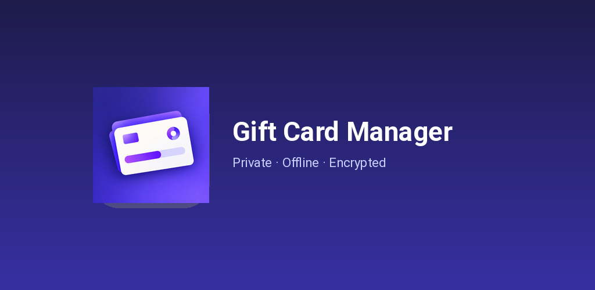
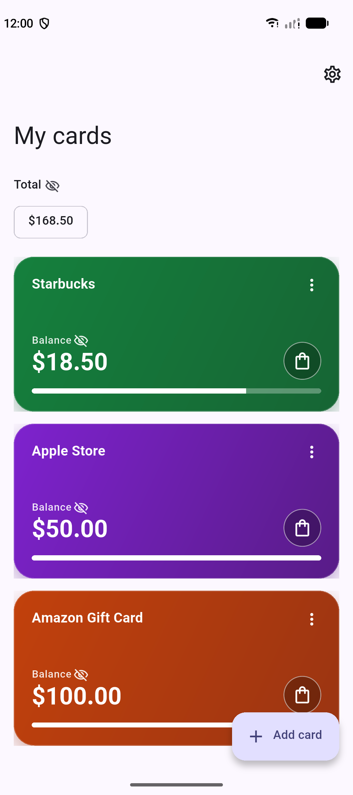
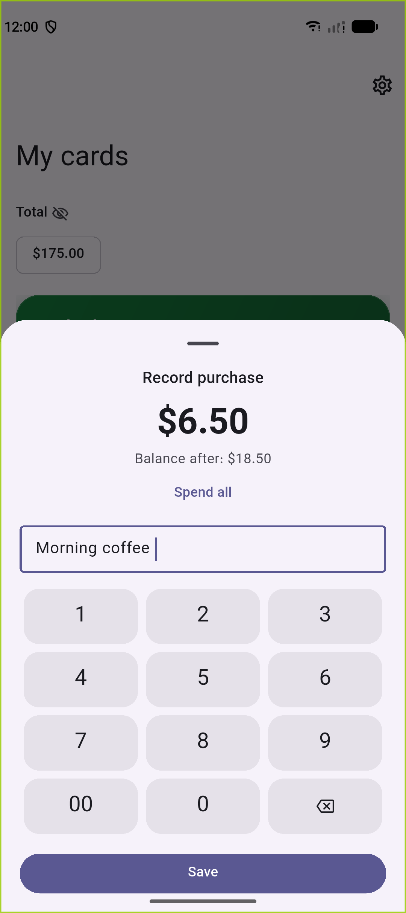
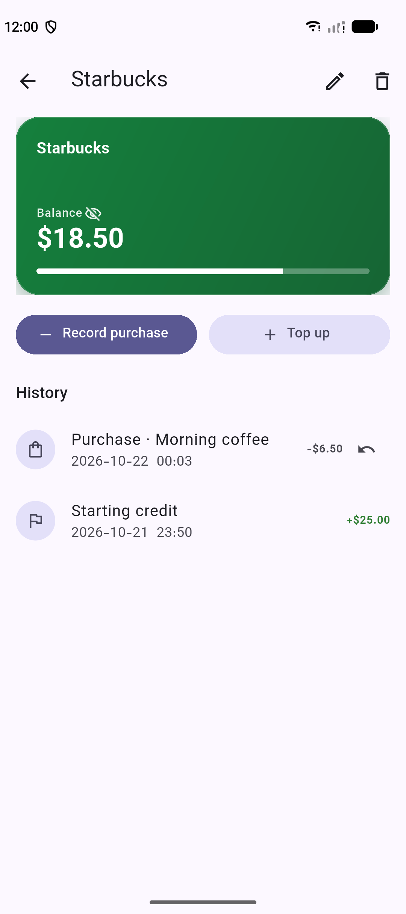
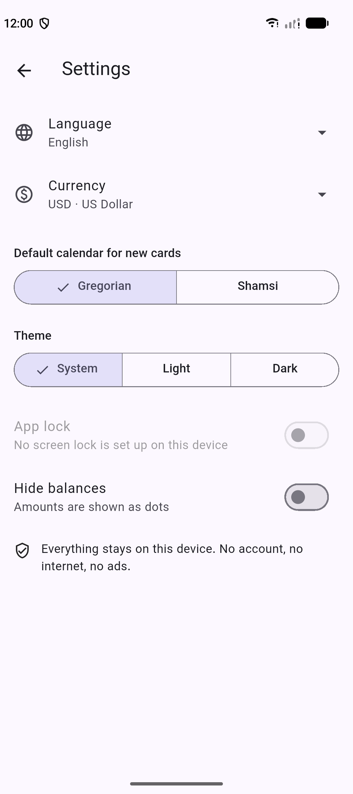

# Gift Card Manager

> Private, 100% offline card balance tracker.

  

A clean, distraction-free utility to track balances, purchases, and expiration dates for your gift cards and vouchers. Built with privacy and local encryption by design.

---

## Features

- **100% Offline & Private:** Zero network permissions. No analytics, no tracking SDKs, no external servers, and no ads.
- **On-Device Encryption:** Card numbers, PINs, and sensitive fields are encrypted in local SQLite storage (AES via `cryptography` + hardware-backed `flutter_secure_storage`).
- **App Lock & Biometrics:** Optional biometric/screen lock protection (`local_auth` / `BiometricPrompt`).
- **Screenshot Protection:** Android `FLAG_SECURE` enabled in release mode prevents leaks in the recent-apps switcher or screen capture.
- **Quick Logging:** One-tap purchase logging, balance adjustment, and instant history undo.
- **Multi-Currency & Calendars:** Full ISO 4217 currencies, Iranian Toman/Rial support, and Gregorian & Jalali (Shamsi) date pickers.
- **Custom Wallet:** Color-coded cards, drag-and-drop reordering, and balance visibility toggle.

---

## Screenshots

  
  
  
  

## Privacy Policy

See [PRIVACY_POLICY.md](PRIVACY_POLICY.md). All data remains strictly on the local device. No user data is collected, stored remotely, or transmitted.
